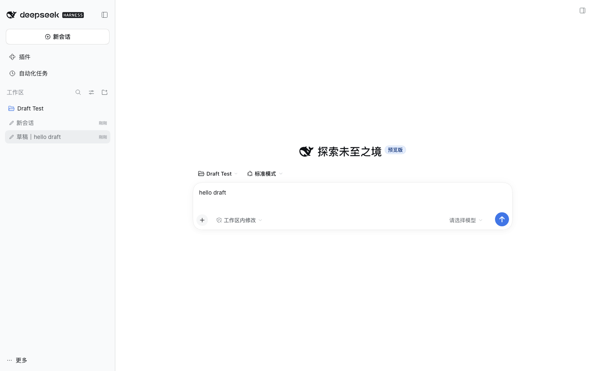

# dsh-draft-rows

[English](README.md) | **简体中文**

未发送的「新会话」会以草稿行的形式留在 DSH 侧边栏；点「新会话」不再每次都新建一个 session id。



- 草稿行实时显示输入框里未发送文字的预览（`草稿｜…`）。
- 新会话优先复用当前 workspace 的**空**草稿；只有所有草稿都有文字时，才新建一个（Cursor / Telegram 的行为）。
- 已经写了文字的草稿保持为独立行；点回去，文字原样恢复。
- 切走再切回、刷新页面，草稿都不会丢。
- 通过行菜单的**归档**丢弃草稿，预览会同步清理。

## 安装

本包是一个 DSH Profile Bundle。由于 `desktop` profile 由 Electron 应用独占，请在应用内安装：

**设置 → 插件 → 添加插件 → 粘贴本地目录路径**，例如
`/Users/lives/Github/ai-catalog/plugins/dsh-draft-rows`，然后重启 DSH。

非 desktop profile 可以使用 CLI：

```bash
dsh plugin --profile web add link:/path/to/ai-catalog/plugins/dsh-draft-rows
```

卸载：在同一个设置页移除插件，或从 profile 的依赖和 bundle 列表中移除 `dsh-draft-rows`，然后重启。

## 新会话模式

默认是 **multi**（复用空草稿；所有草稿都被占用时才新建）。
如果需要 `0.2.1` 之前的**单槽**行为（即使草稿已有文字，也复用 workspace 的那个 blank），改一个 localStorage 键：

```js
localStorage["dsh.drafts.mode"] = "single"; // 然后刷新
```

删除这个键（或设为 `"multi"`）即可恢复默认。

## 存储

- 草稿正文：`dsh.conversation.<sessionId>`（沿用 stock conversation store）。
- 预览镜像：`dsh.drafts.v1`（sessionId → `{ p, at }`），上限 200 条。首次安装时还会扫描 `dsh.conversation.*`，把 stock 0.2.1 遗留的孤儿草稿重新显示出来。
- 插件不会删除会话；丢弃草稿走 stock host 的归档。

## 兼容与失败行为

已在 DSH `0.2.1-rc.2` 上验证。所有补丁都是实例级、带特性检测；服务或形状不匹配时保持 stock 行为不变，只打印一条 warning。client bundle 通过 `window.__ModuleLoader__.load` 加载，与其他 DSH 客户端插件走同一通道。

已知限制：

- stock conversation 快照不包含草稿附件；只有附件的草稿会显示 `[附件]` 预览并被当作“已占用”，但附件本身在切换后仍会丢失。
- 草稿行通过 `sessions.list.getSnapshot` 投影实现；未来 renderer 变化时需要重新验证。预览文字、标题和新会话规则不依赖 DOM class。
- 草稿行禁用了双击重命名（标题由预览决定）；行菜单里的 Rename 仍可能打开，但显示仍以预览为准。

## 目录元数据

`plugin.yaml` 是本插件在 ai-catalog 中的元数据（id、version、status、maintainers、tags），由仓库的 `scripts/validate_metadata.py` 校验。可安装的包就是本目录：`package.json`、`cordis.patch.yml` 和 `lib/` 组成 DSH Profile Bundle。

## 验证

单元测试：`node --test tests/logic.test.mjs tests/apply.test.mjs`。
实现与真实 UI 的 E2E 记录见 [VERIFICATION.md](VERIFICATION.md)。
