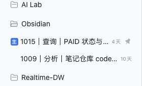
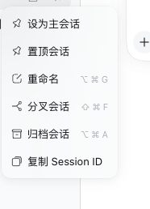

# dsh-primary-session

**English** | [简体中文](README.zh.md)

Mark one pinned **primary session** per workspace in the DSH sidebar.





## What it does

DSH already has **Pin**: a pinned session moves to the top of its workspace
group and keeps a pin icon at the end of the row. It allows several pins per
workspace, though, so with many parallel sessions the pinned section can become
just as homogeneous as the normal list.

This plugin adds one row-menu item on top of Pin:

| Menu item | Behavior |
|---|---|
| **Set as primary** | Unpins every other pinned session **in the same workspace** (or in the ungrouped bucket), then pins the selected session |
| **Clear primary** | Unpins only the selected session; other workspaces are untouched |

The list keeps **one primary per workspace**: the first id of the Host-ordered
pin list that belongs to that workspace. That row gets a compact accent **主**
badge in the row-leading seat (the stock pin icon stays at the row end), and the
row is fronted ahead of normal rows. No new storage, schema, or session event.
Archived rows do not offer the menu item (pin and archive are mutually exclusive
on the Host).

## Install

This package is a DSH Profile Bundle. The `desktop` profile is owned by the
Electron application, so install it from the app:

**Settings → Plugins → Add plugin → paste the local directory path**, e.g.
`/Users/lives/Github/ai-catalog/plugins/dsh-primary-session`, then restart DSH.

For non-desktop profiles the CLI works:

```bash
dsh plugin --profile web add link:/path/to/ai-catalog/plugins/dsh-primary-session
```

### Development mount (mutually exclusive with the bundle install)

While iterating on the plugin, the home-layer patch can mount the package
directly:

```yaml
- insert:
    - id: dsh-primary-session
      name: /Users/lives/Github/ai-catalog/plugins/dsh-primary-session/lib/index.js
```

Do **not** combine this with the Profile Bundle install: the same package would
resolve from two active Loader sources and client-module composition would fail.

## Compatibility and failure behavior

Verified against DSH `0.2.1-rc.2` (desktop). Requires the
`sidebar.workspaces.session.menu.item` slot and the client `workspaces` service
(`list` + `pinSession` / `unpinSession`). If either surface is missing the menu
item does not register; if a Host call fails the plugin logs one warning to the
console and the pin state stays as the Host reported it (there is no toast
channel).

## Storage

No new storage. The plugin reuses the Host's existing pin set
(`<DSH_HOME>/storages/workspace.json` → `global.pinnedSessionIds`), so the
choice survives reloads and is shared across browsers talking to the same Host.

## Limits

- Uniqueness is **per workspace** (the ungrouped bucket counts as one), not
  global.
- Manually pinning a second session breaks uniqueness; the most recent pin
  becomes primary (the badge moves), and choosing **Set as primary** again
  converges the workspace back to one.
- The badge sits in the row-leading seat, which is rendered only while the row
  is idle; a running row shows its status dot there instead. The trailing pin
  icon still marks it.
- Calling the `workspaces` service directly updates the Host pin set and the
  pinned section, but does not rewrite the locally saved manual drag order the
  way the stock Pin button does.

## Uninstall

Remove the plugin in the same Settings page (or delete the home-patch row used
for development), then restart DSH. Unpinning is not required.
